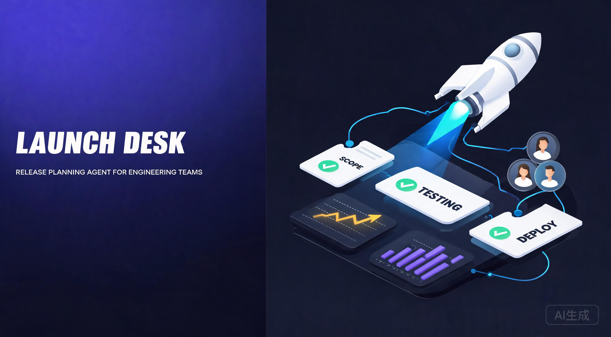

# Launch Desk



Launch Desk is a polished frontend app backed by an OpenAI Agents SDK agent. It helps an engineering team turn a rough launch idea into a release plan with prioritized tasks, launch readiness risks, owner checklists, channel copy, and follow-up questions.

> **📌 此 monorepo 含两个项目**：
> - **Launch Desk**（本文件）— release-planning agent
> - **v3 产链引擎** — see [`V3-README.md`](./V3-README.md) + [`HANDOVER.md`](./HANDOVER.md)
> - **v3 文档中心** — see [`docs/`](./docs/) 21 份文档
>
> **AI 接手指引**：读 [`HANDOVER.md`](./HANDOVER.md)
> **部署**：见 [`DEPLOY.md`](./DEPLOY.md)（生产需 AUTH + Neon）

## Why This Shape

- Frontend: Vite + React, with a streaming SSE client.
- Server/API: Express route at `/api/launch-plan`.
- Agent: `src/agent/launchAgent.ts` defines the OpenAI Agents SDK agent.
- Tools: `src/agent/tools.ts` contains pure helper functions plus SDK function-tool wrappers.
- Tests: `src/tests/tools.test.ts` validates deterministic tool behavior.
- Verification: `scripts/verify-stream.mjs` posts to the local API and reads the stream until tool and model events are observed.

The implementation follows current OpenAI guidance: use the Agents SDK when the app owns orchestration, tool execution, and state; the SDK exposes `Agent`, `run`, function tools, streaming events, and default server-side tracing. The model default is configurable through `LAUNCH_DESK_MODEL`. OpenAI's model docs currently recommend starting with GPT-5.5 for complex reasoning and coding, or choosing a smaller variant such as GPT-5.4 mini for lower latency and cost: https://developers.openai.com/api/docs/models

## Setup

```bash
git clone --recurse-submodules https://github.com/paninick/-agent-.git
cd ./-agent-
npm ci
cp .env.example .env.local
```

If the repository was cloned without its vendor skill repositories, repair it
with `git submodule update --init --recursive`. Production startup fails closed
unless authentication and PostgreSQL persistence are explicitly enabled and
configured; in-memory persistence and unauthenticated mode are development-only.

Edit `.env.local`:

```bash
OPENAI_API_KEY=sk-proj-your-key
LAUNCH_DESK_MODEL=gpt-5.4-mini
PORT=8787
```

The server loads `.env.local` and `.env` through `dotenv`. Make sure the API key is available to the server process, not only to your shell or frontend.

## Run Locally

Start the API:

```bash
npm run dev:server
```

Start the frontend in another terminal:

```bash
npm run dev:web
```

Open http://127.0.0.1:5173.

## Required End-to-End Stream Verification

After the server is running with a real `OPENAI_API_KEY`, run:

```bash
npm run verify:stream
```

The script posts a realistic launch brief to `http://127.0.0.1:8787/api/launch-plan` and fails unless the stream includes at least one `tool_progress` event and one `text_delta` event.

## Tests

```bash
npm run lint
npm run typecheck
npm run test
npm run build
npm run verify:skills
npm run verify:intelligence
npm run verify:release
```

`npm run verify:skills` requires all pinned submodules. It reports quarantined
third-party rejects and fails on missing repositories or rejects beyond the
reviewed baseline. `npm run verify:all` runs environment-shape validation,
secret scanning, and intelligence verification. By default, `verify:env` does
not require a real `.env.local`; it checks that `.env.example` has no real keys
and that local env files are ignored. Use `npm run verify:env -- --strict`
before running real credential-backed source probes. `verify:secrets` scans
Git-tracked files by default so ignored local repair files, vendor references,
and generated media artifacts do not block project validation.

## Release Governance Console

Agent OS v2 includes P8 as a local static release governance layer in `src/release`. It summarizes sealed phases, validation baseline, vendor dirty status, skills health, and the next Handoff Packet.

Run:

```bash
npm run verify:release
```

The command is read-only. It does not call external APIs, does not read credentials, does not connect MCP, does not write Git state, and does not create CI/channel/headless automation. The documented `skills/ECC` nested lockfile drift is classified as non-blocking; unknown dirty files are blocking.

## Intelligence Verification

`npm run verify:intelligence` validates the 23-source intelligence registry through a stabilization layer:

- `sourceCount`: all configured sources in the registry.
- `healthySourceCount`: adapters whose fetch, schema, indicator mapping, and freshness checks all pass.
- `degradedSourceCount`: AdapterHealth three-state compatibility aggregate. It is not the number of partial-data sources. Missing credentials and adapters not yet implemented are aggregated here, so operational review must use `sourceResultBreakdown` and `unavailableSourceBreakdown`.
- `failedSourceCount`: aggregate count for true failure classes only, such as invalid credentials, permission denied, adapter errors, fetch timeouts, or invalid schemas. Do not use it alone for decisions.
- `unavailableSourceCount`: sum of `unavailableSourceBreakdown`.
- `sourceResultBreakdown`: operational classification for every source. Its fields sum to `sourceCount`.
- `failedSourceBreakdown`: true failure classes only: invalid credentials, permission denied, adapter error, fetch timeout, and schema invalid.
- `unavailableSourceBreakdown`: unavailable but not adapter-bug classes: missing credentials, rate limited, not found, adapter not implemented, not probed, and no data.
- `confidenceScore`: rule-based confidence for the current evidence snapshot, not a truth score.
- `visualizationReadiness`: `ready`, `degraded`, or `blocked`.

`missing_credentials` is different from `invalid_credentials`; `permission_denied` is different from missing credentials; `rate_limited` is different from `adapter_error`; `not_found` is different from `no_data`; `not_probed` is different from failed; and `adapter_not_implemented` means the local verification profile has no adapter yet, not that the external source failed.

Current local example:

```json
{
  "sourceCount": 23,
  "healthySourceCount": 5,
  "degradedSourceCount": 18,
  "failedSourceCount": 0,
  "unavailableSourceCount": 18,
  "sourceResultBreakdown": {
    "healthy": 5,
    "missingCredentials": 4,
    "adapterNotImplemented": 14
  },
  "failedSourceBreakdown": {
    "invalidCredentials": 0,
    "permissionDenied": 0,
    "adapterError": 0,
    "fetchTimeout": 0,
    "schemaInvalid": 0
  },
  "unavailableSourceBreakdown": {
    "missingCredentials": 4,
    "adapterNotImplemented": 14
  }
}
```

`verifiedSourceCount` is no longer a core metric because source count does not prove correctness. `npm run verify:intelligence` passing only means the pipeline and output contract are valid. It does not prove a brand supply chain. Degraded output may be used for monitoring and exploration only; it must not be treated as a final decision. Missing credentials lower coverage and confidence.

## Runtime RunStore

Agent OS v2 includes a minimal in-memory runtime in `src/runtime`:

- `MemoryRunStore`: creates and stores `Run` state, checkpoints, and audit event ids.
- `DAGExecutor`: executes workflow nodes, stops at `human_approval` / `waiting_approval`, persists `ResumePoint`, and skips completed nodes on resume.
- `SwarmOrchestrator`: exposes `runIntent`, `getRunState`, `approveRun`, `rejectRun`, and `resumeRun`.

Run status lifecycle:

```text
running -> waiting_approval -> paused -> running -> completed
running -> waiting_approval -> rejected
running -> failed
```

`approveRun` records the approval decision and moves the run to `paused`; it does not mark the run complete. `resumeRun` restores the checkpoint and continues the DAG. This v1 store is process memory only, so run state is lost on process restart. No database, Redis, queue, worker pool, real LLM, or real MCP execution is included.

Approval Queue v1 is not a separate queue. It is expressed as `runStore.listRuns().filter((run) => run.status === "waiting_approval")`. The current `DAGExecutor` is serial. Tool Permission Hooks and Credential Gating are P1 follow-ups after this runtime consistency layer.

## Model Router

Agent OS v2 includes a static Model Router v1 in `src/models`. It selects a model profile for a task, explains why it was selected, and returns a fallback chain. This is only a routing decision layer: it does not call OpenAI, Claude, Gemini, Doubao, or any other real model API, and it does not read API keys.

`ModelProfile` declares `modelId`, `provider`, `capabilities`, `costTier`, `latencyTier`, `contextWindowTier`, `defaultFor`, `fallbackModelIds`, and `enabled`. `ModelSelectionRequest` describes task type, required capabilities, complexity, cost and latency preferences, and privacy level. `ModelSelectionResult` is a safe result union: success includes `selectedModelId` and `estimatedCostTier`; failure returns `ok: false`, `error: "no_model_available"`, `reason`, and `warnings` without requiring `selectedModelId`.

Routing policy favors exact capability matches first. Seed profiles include `doubao-seed-2.0-pro`, `deepseek-v4-flash`, and `ark-code-latest` as static profiles only. Simple classification prefers low-cost fast profiles; complex or critical work prefers reasoning; code tasks prefer coding; document analysis prefers long context. Tie-breaks are deterministic: policy score, cost tier, latency tier, larger context window, then profile order. Sensitive privacy requests emit a warning only; Model Router v1 does not block, approve, redact, or enforce credential policy. Disabled models are never selected.

If a future `ModelRegistry` is introduced, it should remain the model registration/profile source. `ModelRouter` is the selection decision layer over those profiles; the two should not become competing model sources.

## Tool Permission Governance

Agent OS v2 includes P3 static governance in `src/governance`, the current policy-as-library implementation directory. `preToolUseHook` evaluates a proposed tool call before execution and returns `allow`, `deny`, or `requires_approval` with credential status, risk level, risk vector, reasons, warnings, and an audit event payload. `postToolUseHook` records an observation payload, but it does not execute tools.

P3 v1 is rule-based only. It does not read real credentials, call real APIs, connect to MCP, invoke a sandbox, or enforce organization RBAC. `CredentialStatus` is caller-provided static input and is separate from P0 `SourceResultStatus`. P3 v1 supports caller-provided scope coverage gating: `requestedScopes` must be covered by `grantedScopes` when credentials are marked available. `AgentRiskVector` scores data sensitivity, tool effect, credential exposure, network exposure, external writes, destructive actions, and cost exposure; it is not CVSS and not a security certification score.

`requires_approval` is only a P3 decision status. It does not trigger P1 `waiting_approval`, does not call `runStore.updateRun`, does not append runtime audit events, does not create a `ResumePoint`, and does not change `RunStatus`. Mapping P3 `requires_approval` into the P1 approval flow is a future orchestration decision. P3 v1 does not implement `log_only`; use `status: "allow"` plus `auditEventRequired: true` for allowed calls that must still be audited. `ToolAuditEvent` is a payload only and is not automatically persisted.

## MCP Gateway Registry

当前所有 MCP 工具调用均为 mock / synthetic result，不执行真实外部工具。

Agent OS v2 includes P4.0 as the static registry and tool descriptor layer for the MCP Gateway in `src/mcp`. It defines `McpServerProfile`, `McpToolDescriptor`, `McpTransportType`, `McpAuthRequirement`, `McpHealthStatus`, `ToolCallRequest`, `ToolCallResult`, `McpError`, and the `McpGatewayRegistry` query interface. P4.0 is a static registration and description layer, not a running gateway process.

The implemented P4.0 modules include `McpGatewayRegistry`, seed MCP server descriptors, `mockToolCall`, `createMcpError`, `RETRYABLE_MAP`, and declared health helpers. The registry supports safe register / get / list behavior for static profiles and descriptors only.

P4.0 v1 does not connect to real MCP servers, does not perform real SSE / streamable_http / stdio transport, does not read real API keys, and does not call external tools. `McpTransportType` is a declared enum value, not a connection action. `McpAuthRequirement` is a static declaration of what auth a server requires; it is not `CredentialStatus` (which is P3 runtime input) and P4.0 does not compute, read, or carry credential status. `McpToolDescriptor.declaredEffect` is a P3 risk-calculation input; P4.0 does not output `riskLevel` or `requiresApproval`. mock tool call results are synthetic and do not execute real tools, do not call `preToolUseHook` / `postToolUseHook`, and do not write RunStore audit; `ToolCallResult.auditPayload` is a payload only and is not automatically persisted.

`McpHealthStatus` is independent of P0 `SourceResultStatus`; P4.0 does not import P0 intelligence types and does not import P3 governance functions. P4.0 does not call RunStore, does not change `RunStatus`, and does not create `ResumePoint`. Real MCP transport, real tool execution, real credential resolution, dynamic tool discovery, and runtime governance integration are deferred to P4.1 and P4.2. See [docs/MCP_GATEWAY_REGISTRY_RUNBOOK_CN.md](docs/MCP_GATEWAY_REGISTRY_RUNBOOK_CN.md).

## MCP Transport Interface

Agent OS v2 includes P4.1 as the MCP transport abstraction and fake transport harness layer in `src/mcp`. It defines `McpTransport` interface (`healthProbe`, `listTools`, `callTool`), `McpTransportRequest`, `McpTransportResponse` (discriminated union), `McpTransportError` (reuses `McpErrorKind`), and `FakeMcpTransport` class with `FakeTransportConfig.errorOverrides` for structured synthetic error injection. P4.1 is a transport interface + fake implementation only, not a real MCP connection.

The implemented P4.1 modules include `McpTransport` interface, `FakeMcpTransport` class, `FakeTransportConfig` with `errorOverrides`, and transport-layer types. `FakeMcpTransport` implements `McpTransport` against `McpGatewayRegistry` (P4.0) — it returns synthetic success results and synthetic errors (timeout / rate_limited / server_error / etc.) per config-driven `errorOverrides`. No network, no subprocess, no real MCP client.

P4.1 v1 does not connect to real MCP servers, does not perform real SSE / streamable_http / stdio transport, does not read real API keys, does not call P3 `preToolUseHook` / `postToolUseHook`, and does not write RunStore audit. `FakeTransportConfig.errorOverrides` replaces the P4.0 `__mockErrorKind` magic string with structured per-server / per-tool / per-call error injection. `mockToolCall.ts` is deprecated (kept for P4.0 back-compat). Real MCP transport, real tool execution, real credential resolution, and runtime governance integration are deferred to P4.2. See [docs/MCP_TRANSPORT_INTERFACE_RUNBOOK_CN.md](docs/MCP_TRANSPORT_INTERFACE_RUNBOOK_CN.md).

## Model Gateway

Agent OS v2 includes a Model Gateway in `src/integration/` that executes real model API calls with automatic primary→fallback switching. It consumes `ModelRouter` (P2) output (`selectedModelId` + `fallbackModelIds`) and routes to 4 providers: DeepSeek, 火山引擎/豆包, OpenRouter, and longcat. All providers use OpenAI-compatible chat completions API format.

The implemented modules include `ModelGateway` interface, `ModelGatewayImpl` (real HTTP calls via `fetch`), `FakeModelGateway` (synthetic responses for testing), `ProviderConfig` with 4 default providers, and `resolveProvider` / `resolveApiKey` / `resolveProviderModelId` helpers. When a primary model fails (rate_limited, server_error, network_error, auth_failed, timeout), the gateway automatically switches to the next fallback in the chain. All candidates exhausted → `all_providers_failed`.

API keys are read from `process.env` (`DEEPSEEK_API_KEY`, `ARK_API_KEY`, `OPENROUTER_API_KEY`, `LONGCAT_API_KEY`) — the only module allowed to do so. `src/models/` remains sealed and unmodified; the existing boundary-protection test asserting `"callModel" in router === false` still passes. `FakeModelGateway` does not call `fetch` and is used for all test scenarios. See [docs/MODEL_GATEWAY_RUNBOOK_CN.md](docs/MODEL_GATEWAY_RUNBOOK_CN.md).

## Tool Execution Adapter + Audit Bridge

Agent OS v2 includes a `ToolExecutionAdapter` in `src/integration/` that assembles the full P4.2 execution chain: `buildInvocationRequest → preToolUseHook (P3) → McpTransport.callTool (P4.1) → postToolUseHook (P3) → RunStore.appendAuditEvent (P1)`. It maps `McpDeclaredEffect → ToolEffect` (read→read, write→write, destructive→delete, network→external_send, compute→execute) and bridges P3 `ToolAuditEvent` + P4.1 `AuditEventPayload` into P1 RunStore audit persistence. `src/runtime/dagExecutor.ts` is NOT modified — the adapter calls sealed layers through their public interfaces.

## Skill Progressive Loading + Context Budget

Agent OS v2 includes a `src/skills/` static layer (P5) that estimates skill token overhead, classifies skills by priority, and reports context-budget utilization before skills are loaded into the prompt. The implemented modules include `estimateTokens` / `estimateTokensFromSize` (prose `words × 1.3`, code `chars / 4`, auto-detection via code-character ratio), `SkillRegistry` (in-memory descriptor + estimate lookup), `loadSkill` (returns a `SkillLoadResult` discriminated union: `loaded` / `not_found` / `exceeds_budget` / `parse_error`, with an injected `readFile` so tests stay filesystem-free), `classifySkill` / `classifyAll` (`always_needed` / `sometimes_needed` / `rarely_needed` via id hints or description keywords), `computeAllocation`, and `generateReport` (warns at >80% utilization, flags budget exceeded, suggests removing rarely-needed skills and lazy-loading >5 sometimes-needed skills).

The layer is a pure static library: no `fetch`, no `process.env`, no RunStore, no MCP, no governance hooks. `src/skills/` imports nothing from `src/integration`, `src/governance`, `src/runtime`, `src/mcp`, `src/models`, or `src/intelligence` — all sealed layers remain unmodified. Tier defaults follow the `context-budget` SKILL.md heuristics: `small: 8_000`, `medium: 32_000`, `large: 200_000` tokens; reserved `MODEL=4_000`, `SYSTEM=2_000`. See [docs/SKILL_PROGRESSIVE_LOADING_RUNBOOK_CN.md](docs/SKILL_PROGRESSIVE_LOADING_RUNBOOK_CN.md).

## Model Gateway Integration

Launch Desk now routes model calls through the Model Gateway (`src/integration/`) instead of the SDK's built-in OpenAI client. A custom SDK `Model` adapter (`src/agent/modelGatewayAdapter.ts` — `ModelGatewayModel implements Model`) wraps `ModelGateway.callModelStream`, enabling the OpenAI Agents SDK's `run({ stream: true })` to call third-party providers (DeepSeek, 火山引擎/豆包, OpenRouter, longcat) while preserving token-by-token SSE streaming, the tool-call loop, and tracing.

`LAUNCH_DESK_MODEL` now accepts any model id available via `gateway.getAvailableModels()` — e.g. `deepseek-v4-flash`, `doubao-seed-2.0-pro`, `ark-code-latest`, `longcat-v1`. If no provider keys are configured, the agent falls back to the SDK default provider (string model). The server pre-flight check is relaxed: at least one provider key (`DEEPSEEK_API_KEY` / `ARK_API_KEY` / `OPENROUTER_API_KEY` / `LONGCAT_API_KEY`) OR `OPENAI_API_KEY` is required. See [docs/MODEL_GATEWAY_INTEGRATION_RUNBOOK_CN.md](docs/MODEL_GATEWAY_INTEGRATION_RUNBOOK_CN.md).

## Skill Injection

The agent's instructions are now parameterized: `src/agent/skillInjector.ts` loads skill content per-request, classifies skills by priority (`always_needed` loaded mandatorily, `sometimes_needed` loaded while budget remains, `rarely_needed` skipped), and prepends a `## Loaded Skills` block to the agent's system instructions. This connects the P5 skills layer to the execution chain without coupling `src/skills/` to any sealed layer — the agent imports skills, not the reverse. `src/agent/launchAgent.ts` accepts `{ skillContent?, model? }` options; `src/agent/streamLaunchPlan.ts` wires the gateway and skill injector together.

## Model Router + Skill Scanner Integration

Launch Desk now uses the static `ModelRouter` before constructing the `ModelGatewayModel`. `src/agent/modelRouterIntegration.ts` builds the release-planning selection request, selects a router model, filters fallback candidates to models currently available through `gateway.getAvailableModels()`, and preserves the SDK-default string model path when no provider key is configured.

`src/skills/skillScanner.ts` recursively scans a configured skill root (`SKILLS_ROOT`, default `skills/ECC/skills`) for `SKILL.md`, parses frontmatter into `SkillDescriptor[]`, and registers descriptors with size-based token estimates. The scanner is filesystem-injected for tests and does not execute skill content. `streamLaunchPlan` uses this registry best-effort with `loadSkillsForAgent`; scan or load failures leave the agent running without injected skills.

## E2E Runtime Smoke Test

`src/tests/e2e-runtime-smoke.test.ts` exercises the full agent run path end-to-end without real network calls. It injects a `FakeModelGateway` via `setGateway()` and an empty skill registry via `setSkillRegistry()`, then drives `streamLaunchPlan()` with a valid `LaunchInput` and asserts: `run_started` / `text_delta` / `run_completed` events, skill-injection into agent instructions, `ModelRouter` selection + fallback when the selected model is not in the gateway, gateway error propagation, tool-call extraction from embedded JSON fences, and that `fetch` is never called. The production lazy-init path in `streamLaunchPlan.ts` is unchanged — the test-injection exports only override module-level singletons.

## HTTP/SSE Integration Test

`src/tests/http-sse-integration.test.ts` is the project's first HTTP-level integration test. It starts a temporary `http.createServer` on a random port (`:0`) using `createApp(fakeGateway)` — the factory extracted from `src/server/index.ts` — and sends real HTTP requests with Node's built-in `http` module (zero new dependencies). The test matrix covers `GET /api/health` (ok flag, availableModels, hasProviderKey) and `POST /api/launch-plan` (SSE framing, happy path, Zod validation errors, missing fields, preflight failure, gateway error propagation, and a `fetch` boundary assertion). The server's `app.listen()` is guarded with an ESM entry-point check so importing `createApp` in a test does not start the listener.

## Runs REST API

`src/server/index.ts` exposes the `SwarmOrchestrator` approval/resume workflow over 7 REST endpoints:

| Method | Path | Description |
|--------|------|-------------|
| POST | `/api/runs` | Create a run from `{ intent: string }` |
| GET | `/api/runs` | List all runs |
| GET | `/api/runs/:runId` | Get a single run state |
| POST | `/api/runs/:runId/approve` | Approve a waiting_approval run |
| POST | `/api/runs/:runId/reject` | Reject a waiting_approval run |
| POST | `/api/runs/:runId/resume` | Resume a paused run to completion |
| GET | `/api/runs/:runId/audit` | Get audit events for a run |

The `createApp(gateway?, orchestrator?)` factory accepts an optional `SwarmOrchestrator` for test injection. Error responses use deterministic mapping: `run_not_found` → 404, `invalid_state` → 409, Zod validation errors → 400.

`src/tests/http-runs-api.test.ts` provides 13 HTTP integration tests covering the full lifecycle: create → list → inspect → approve → resume → completed, plus rejection, invalid state transitions, missing runId, and audit trail verification. All tests use Node's built-in `http` module (zero new dependencies).

## Agent Runtime Bridge

P13 connects the Launch Desk SSE stream to the existing runtime approval surface without changing `src/runtime/**`. When `createApp(fakeGateway, orchestrator)` receives `/api/launch-plan`, it creates a runtime run, attaches `runId` to the `run_started` SSE event, emits `approval_required` after agent generation, and waits for `/api/runs/:runId/approve` or `/api/runs/:runId/reject` before completing or rejecting the SSE stream.

This bridge is intentionally thin: no new runtime status, no RunStore schema change, no real MCP, no new credentials, and no new dependencies. Calling `createApp(gateway)` without an injected orchestrator keeps the previous behavior: `run_completed` is emitted directly and no approval gate is inserted.

## Vercel Deployment Readiness

P14 adds the minimal Vercel deployment shape for the Vite + Express app without performing a real deployment. `vercel.json` builds the static frontend with `npm run build`, serves `dist/client`, rewrites `/api/*` to `api/index.ts`, and sends all other paths to `index.html`.

`api/index.ts` exports the existing `createApp()` Express app as the serverless handler, so the deployed API uses the same server routes as local development. P14 does not create `.vercel/**`, does not commit Vercel project ids, does not read or write `VERCEL_TOKEN`, and does not add CI.

## Client UI Component Test

`src/tests/client-ui.test.tsx` is the project's first client-side React component test. It uses jsdom (already a devDependency) with a `// @vitest-environment jsdom` file-level pragma, React's own `act` utility, and `ReadableStream`/`TextDecoder` polyfills to simulate the SSE response body — zero new npm dependencies.

The 13-test suite covers: `parseSseBlock` event/data extraction (3), `Field` component rendering + `onChange` interaction + default rows (3), `App` initial render with title/form/empty-state/zero-metrics (3), `App` SSE stream consumption with `text_delta` concatenation / error banner / `run_completed` metrics (3), and a fetch boundary assertion confirming only `/api/launch-plan` is called (1). `src/client/main.tsx` exports `App`, `Field`, and `parseSseBlock` for testability; the `createRoot` side-effect is guarded with `typeof document !== "undefined"` so test imports are safe without a DOM root element.

## Vercel Deployment Execution Gate

P15 documents the real Vercel deployment gate after P14 readiness. It is documentation-only: it does not deploy, does not create `.vercel/**`, does not add CI, and does not read or write credentials.

Before a live deployment can be treated as release evidence, an operator must complete valid Vercel auth and project linking outside the repository, then run `vercel pull --yes`, `vercel build --yes`, and `vercel deploy --prebuilt`. Production deploy remains a separate explicit action. Current local evidence shows Vercel CLI is present, but real build/deploy is environment-blocked until auth is valid. See [docs/AGENT_OS_V2_P15_VERCEL_DEPLOYMENT_EXECUTION_GATE_CN.md](docs/AGENT_OS_V2_P15_VERCEL_DEPLOYMENT_EXECUTION_GATE_CN.md).

## Multi-Model Consistency

Agent OS v2 uses fixed model roles and fixed validation nodes to avoid prompt drift, duplicated decisions, and cross-stage scope creep.Every model must operate inside a declared node:
PRD -> Architecture Review -> Technical Review -> Implementation -> Code Review -> Validation -> Documentation Sync -> Release Seal.

Each node must output `STATUS` and `NEXT_NODE`. Non-blocking nodes may not pause with open-ended confirmation requests.

See [docs/AGENT_OS_V2_MULTI_MODEL_CONSISTENCY_CN.md](docs/AGENT_OS_V2_MULTI_MODEL_CONSISTENCY_CN.md).

## Code Guardrails

Agent OS v2 uses module boundaries and phase gates to prevent runtime monolith growth.

Static layers must be implemented before runtime integration. No module may import another layer unless a dedicated integration phase allows it.

See [docs/AGENT_OS_V2_CODE_GUARDRAILS_CN.md](docs/AGENT_OS_V2_CODE_GUARDRAILS_CN.md).

## Vendor Tooling Standard

Agent OS v2 may be developed with Codex, Claude Code, ZCode, Doubao Code, Kimi Code, DeepSeek, GLM, LongCat, and other agents.

Vendor-specific files such as `AGENTS.md`, `CLAUDE.md`, `.claude/`, skills, hooks, and MCP configuration are adapter layers only. They must not redefine project phases, release gates, module boundaries, or runtime behavior.

See [docs/AGENT_OS_V2_VENDOR_TOOLING_STANDARD_CN.md](docs/AGENT_OS_V2_VENDOR_TOOLING_STANDARD_CN.md).

## Extend The Agent

1. Add a pure helper function to `src/agent/tools.ts`.
2. Wrap it with `tool({ name, description, parameters, execute })`.
3. Add it to `launchDeskTools`.
4. Update the agent instructions in `src/agent/launchAgent.ts` if the new tool should be required.
5. Add or update a focused Vitest case.

Good next tools include release-note diffing, launch calendar generation, ownership directory lookup, experiment guardrails, or handoff to a legal/privacy specialist agent.

## Observability

The Agents SDK enables tracing by default in Node server runtimes. Launch Desk wraps each run in `withTrace("Launch Desk release plan", ...)` and calls `getGlobalTraceProvider().forceFlush()` when the stream completes. Set `OPENAI_AGENTS_DISABLE_TRACING=1` if your environment should not export traces.

## Validation

Use [docs/VALIDATION_CHECKLIST.md](docs/VALIDATION_CHECKLIST.md) before changing launch behavior or adding tools.

## Release Operations Pack

Launch Desk ships a documentation pack for release operations, demos, acceptance, and troubleshooting. These are documentation-only references — they do not modify `src/*` or `package.json`.

- [docs/LAUNCH_DESK_RELEASE_RUNBOOK.md](docs/LAUNCH_DESK_RELEASE_RUNBOOK.md) — environment, install/start/test commands, tag/commit verification, bundle/zip recovery, secrets scan, localStorage key verification, history cleanup, sealed baseline info
- [docs/LAUNCH_DESK_DEMO_SCRIPT.md](docs/LAUNCH_DESK_DEMO_SCRIPT.md) — 6 demos: normal streaming, approve path, reject safe path, ledger after completion, local history list/detail/export/clear, no Future features present
- [docs/LAUNCH_DESK_ACCEPTANCE_CHECKLIST.md](docs/LAUNCH_DESK_ACCEPTANCE_CHECKLIST.md) — 71-item acceptance checklist: 7 SSE events frozen, approval contract frozen, ledger read-only, history localStorage-only, payloadPreview not persisted, no Cancel/Retry/run_cancelled/recoverable, tests pass, secrets 0
- [docs/LAUNCH_DESK_TROUBLESHOOTING.md](docs/LAUNCH_DESK_TROUBLESHOOTING.md) — dev server cannot start, browser history not appearing, localStorage corrupted, approval gate not appearing, export markdown not downloading, verify:secrets false positive, skills/ECC submodule appears modified
