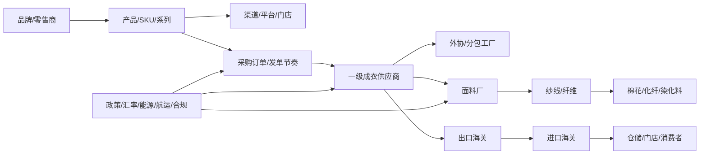

# 全产业链情报 Agent：全球监控与信源可靠性验证规格

更新日期：2026-06-30

## 1. 定义成功

这个系统不是“搜索后总结”，而是“从任意产业链节点反推全链路是否真实通畅”。成功必须同时满足五个条件：

1. 财报数据能落到业务链条：收入、毛利、库存、采购、资本开支、门店/渠道扩张可以解释订单变化。
2. 供应商出货量、出口方海关、收货方海关能互相对应，允许时间差、HS 口径差和转口误差，但必须标出误差来源。
3. 面料、纱线、辅料、成衣数量能用 BOM、损耗率、单位换算反推，不允许只看金额。
4. 营销、价格、折扣、平台反馈、用户评价、品牌定位和产品策略能解释需求变化。
5. 任何结论都有反证通道：如果某个证据链断掉，系统必须把它标成假设，而不是结论。

最低输出不是一份报告，而是一张 Evidence Graph：

```text
结论 = SourceNode + DataPointNode + IndicatorNode + EntityNode + EvidenceEdge + ConflictReport + confidenceScore
```

## 2. 核心判断方式

我们要从“富泉能卖给谁”升级为“哪些品牌的采购逻辑、供应链脆弱性和产品策略，刚好需要富泉这类能力”。

品牌优先级高于供应商视角：

- 品牌战略：原创、白牌、抄袭、快速跟随、设计师驱动、渠道驱动、价格驱动。
- 用户变化：评论、搜索热度、折扣率、复购、尺码/面料投诉、退货信号。
- 产品变化：品类扩张、版型变化、材质变化、系列节奏、上新频率。
- 发单策略：大单长单、小单快反、测试单、柔性补单、ODM/OEM/OBM 混合。
- 供应链管理：是否压价、是否稳定合作、是否要求合规、是否多国分散。
- 脆弱性：单一产地、单一面料、关税暴露、汇率暴露、航运暴露、劳动合规暴露、库存暴露。

供应商机会来自品牌的真实约束，而不是供应商的自我介绍。

## 3. 产业链图谱

第一批以服装产业为测试，图谱最小闭环如下：



每个节点都要有实体 ID、地区、时间、数据口径、来源等级和关联强度。没有 ID 的文本信息只能做线索，不能直接入结论。

## 4. 证据权重

| 等级 | 证据类型 | 默认用途 | 示例 |
|---|---|---|---|
| S | 官方 API、公司原始披露、交易/海关原始记录 | 定量主证据 | UN Comtrade、SEC EDGAR、EDINET、USITC、Eurostat、World Bank、FRED、BLS |
| A+ | 授权平台接口、公司财报结构化解析、供应商直接披露 | 经营验证 | Shopee/Temu 授权订单、通达信财报、供应商公告 |
| A | 政府统计、行业协会、合规数据库、权威研究 | 口径校准 | e-Stat、Open Supply Hub、Better Work、ILO、WTO、IDB |
| B | 咨询报告、专业媒体、招聘、新闻、网页 | 假设生成和风险预警 | McKinsey/BoF、Vogue Business、招聘平台、地方媒体 |
| C | 未授权抓取、社媒传言、二手转述 | 只能做线索 | 网页碎片、论坛、未验证自媒体 |

权重不是静态分数。每条数据还要乘以：

- `recency_factor`：越新越高，财报和海关按披露周期衰减。
- `method_factor`：API/结构化高于网页文本，高于人工转述。
- `chain_alignment`：与其他账本同向时提高，与硬数据冲突时降低。
- `contradiction_penalty`：发现反证必须扣分，不能只叠加正向证据。

建议置信度框架：

```text
confidence = source_weight * recency_factor * method_factor * chain_alignment - contradiction_penalty
```

达到“结论”必须同时看单条证据置信度和证据快照 `confidenceScore`。只有 B/C 证据、缺跨源一致性、缺关键账本或存在未解释冲突时，只能输出“线索”或“假设”。

## 4.1 Evidence Graph v1

当前信源可靠性验证使用 Evidence Graph v1，而不是只看 source registry。

| 节点/边 | 含义 |
|---|---|
| `SourceNode` | 数据源、权重、层级、授权状态、健康状态。 |
| `DataPointNode` | 标准化后的观测值、时间窗口、单位和 provenance。 |
| `IndicatorNode` | 指标类型、单位、业务账本类别。 |
| `EntityNode` | 国家、行业、公司或指标主体。 |
| `EvidenceEdge` | `derived_from`、`describes`、`supports`、`contradicts` 四类连接。 |
| `ConflictReport` | value、unit、time window 三类规则冲突报告。 |

Verification Engine v1 输出：

```text
confidenceScore =
  0.30 * sourceReliability
+ 0.25 * dataCompleteness
+ 0.20 * freshnessScore
+ 0.15 * crossSourceAgreement
- 0.10 * conflictPenalty
```

`confidenceScore` 替代把 `verifiedSourceCount` 当作核心判断的做法。源数量只能说明覆盖，不代表信源可靠性。

Adapter Result Classification v1 额外输出：

- `sourceResultBreakdown`：所有 source 的运维分类，合计必须等于 `sourceCount`。
- `failedSourceBreakdown`：只统计 `invalidCredentials`、`permissionDenied`、`adapterError`、`fetchTimeout`、`schemaInvalid`。
- `unavailableSourceBreakdown`：统计 `missingCredentials`、`rateLimited`、`notFound`、`adapterNotImplemented`、`notProbed`、`noData`。
- `unavailableSourceCount`：`unavailableSourceBreakdown` 的合计。

`degradedSourceCount` 是 AdapterHealth 三态兼容聚合值，不等于 partial data source 数量。`failedSourceCount` 是聚合值，不能单独用于判断。`missing_credentials` 不等于 `invalid_credentials`；`adapter_not_implemented` 说明本地验证 profile 还没有 adapter，不表示外部 source 失败。`verify:intelligence` 通过只表示管线级验证通过，不表示品牌供应链已验证。

## 5. 官方与免费 API 源

这些源适合优先做 MCP/adapter，因为它们相对正规、可追溯、可程序化。

| 领域 | 源 | 用途 | 接入状态判断 |
|---|---|---|---|
| 全球贸易 | [UN Comtrade](https://comtrade.un.org/) | 国家、伙伴国、HS 编码、年度/月度贸易 | S 级，适合全局镜像验证 |
| 全球贸易/关税 | [World Integrated Trade Solution API](https://wits.worldbank.org/witsapiintro.aspx?lang=en) | UNCTAD TRAINS、关税、HS 编码、贸易政策镜像 | S 级，公开 API；本机 HS6 样例需继续调参和超时治理 |
| 供应链设施 | [Open Supply Hub API](https://info.opensupplyhub.org/api) | 工厂地点、OS ID、设施去重 | A 级，开放数据可用，规模化 API 可能需申请 |
| 美国上市公司 | [SEC EDGAR APIs](https://www.sec.gov/search-filings/edgar-application-programming-interfaces) | 10-K/10-Q/8-K、XBRL、供应链披露 | S 级 |
| 日本统计 | [e-Stat API](https://www.e-stat.go.jp/api/en) | 日本官方统计、消费、产业、贸易相关口径 | S/A 级，需要 appId |
| 美国贸易 | [USITC DataWeb API](https://datawebws.usitc.gov/dataweb/swagger-ui/index.html) | 美国进口/出口、关税、HTS | S 级，需要账号/API token |
| 美国贸易 | [U.S. Census International Trade API](https://www.census.gov/data/developers/data-sets/international-trade.html) | 美国 HS 级进口/出口、伙伴国、月度贸易 | S 级，需要 API key |
| 宏观 | [World Bank Indicators API](https://datahelpdesk.worldbank.org/knowledgebase/articles/889392-about-the-indicators-api-documentation) | GDP、能源、劳动力、贸易指标 | S 级，公开 API |
| 宏观/政策 | [OECD Data Explorer](https://data-explorer.oecd.org/) | OECD 国家宏观、产业、价格、劳动、贸易数据 | S 级，公开数据；SDMX 维度复杂，待 adapter |
| 利率/汇率/宏观 | [FRED API](https://fred.stlouisfed.org/docs/api/fred/) | 利率、汇率、通胀、能源等时间序列 | S 级，需要 API key |
| 价格/劳工/通胀 | [BLS Public Data API](https://www.bls.gov/developers/) | 美国 CPI/PPI/就业/工资时间序列，可跟踪服装价格和成本环境 | S 级，公开 API |
| 汇率 | [ECB euro foreign exchange reference rates](https://www.ecb.europa.eu/stats/policy_and_exchange_rates/euro_reference_exchange_rates/html/index.en.html) | EUR 基准汇率、USD/JPY 交叉汇率校验 | S 级，公开 XML |
| 欧洲统计 | [Eurostat Statistics API](https://ec.europa.eu/eurostat/web/user-guides/data-browser/api-data-access/api-getting-started) | EU 贸易、产业、消费、价格 | S 级，公开 REST |
| 劳动力/工资 | [ILOSTAT API](https://ilostat.ilo.org/resources/concepts-and-definitions/ilostat-api/) | 就业、工资、工时、劳动统计 | S 级，公开 API；指标维度复杂，待稳定探针 |
| 电商平台 | [Shopee Open Platform](https://open.shopee.com/developer-guide/4) | 商品、订单、店铺、营销、聊天 | A+ 级，需要卖家授权 |
| 电商平台 | [Temu Partner API](https://partner.temu.com/documentation?menu_code=38e79b35d2cb463d85619c1c786dd303) | 订单、商品、库存、履约 | A+ 级，需要卖家授权 |
| 阿里生态 | [Alibaba Open Platform](https://openapi.alibaba.com/doc/doc.htm) / [淘宝开放平台](https://developer.alibaba.com/docs/doc.htm?articleId=108101&docType=1&treeId=502) | 商品、订单、物流、图片、结算 | A+ 级，需要正式授权；1688 公开第三方 API 需谨慎降权 |

研报和专家源用于解释机制，不替代账本：

- [McKinsey/BoF State of Fashion 2026](https://www.mckinsey.com/industries/retail/our-insights/state-of-fashion)：关税、AI、消费者、供应链压力。
- [ILO Asian garment sector report](https://www.ilo.org/publications/employment-wages-and-productivity-asian-garment-sector-taking-stock-recent)：亚洲服装就业、工资、生产率。
- [Better Work data and transparency](https://betterwork.org/data-and-evidence/)：服装工厂合规、劳动条件、企业表现。
- [IDB textile and clothing GVC analysis](https://publications.iadb.org/en/analysis-textile-and-clothing-industry-global-value-chains)：纺织服装全球价值链结构。
- [WTO textiles and clothing GVC profile](https://www.wto.org/english/res_e/statis_e/miwi_e/gvc_sectoral_profiles_textiles_clothing24_e.pdf)：纺织服装在全球贸易中的位置和投入产出结构。

## 6. 多账本交叉验证

### 6.1 财务账本

从财报和公告提取：

- 收入、毛利、库存、存货周转、采购承诺、资本开支。
- 地区收入、渠道收入、品类收入。
- 供应商集中度、重大合同、关联交易。
- 风险披露中的关税、汇率、航运、原材料、劳动合规。

### 6.2 海关账本

从出口国和进口国两边拉：

- HS 编码、金额、重量、数量、伙伴国、时间。
- 出口国申报与进口国申报差异。
- 转口、FOB/CIF、汇率、统计时间差。
- 国家层级先跑通，再逐步接商业海关到公司/提单级。

### 6.3 物料账本

用 BOM 反推：

```text
成衣数量 * 单件面料耗用 / 裁剪利用率 = 面料需求
面料需求 * 克重/成分 = 纱线/纤维需求
纱线需求 / 纺纱得率 = 原料需求
```

如果品牌销售增长、海关成衣增长、供应商产能增长、纱线/面料消耗增长不能互相解释，系统要标出异常。

当前实现中，物料账本使用更明确的 kg 核算：

```text
netFabricKg = finishedUnits * fabricKgPerUnit
grossFabricKg = netFabricKg / (1 - cuttingWasteRate)
yarnInputKg = grossFabricKg / yarnToFabricYieldRate
fiberInputKg = yarnInputKg / fiberToYarnYieldRate
```

模型输出只说明“物理量应该是多少”。只有和真实 BOM、供应商发货、仓库台账或海关数量对齐后，才允许进入 `material_quantity` 证据。

### 6.4 市场账本

从平台和公开前端观察：

- SKU 上新、价格、折扣、断码、评论量、退货抱怨。
- Temu、Shopee、1688 对价格锚点、白牌供给、工厂直营和品牌毛利的影响。
- 品牌是否被迫调整定位：降价、换料、缩短周期、增加基础款、转向更低成本产地。

### 6.5 合规账本

监控：

- 劳工、消防、环保、制裁、强迫劳动、税务、诉讼、召回。
- Better Work、Open Supply Hub、政府处罚、法院公告、媒体调查。
- 供应商换厂、外协、异常扩产和实际产能不匹配。

## 7. 成本和利润拆分模型

利润率不能单独看。任何“20% 利润”的判断都要拆成步骤，并绑定证据源：

| 成本项 | 需要的数据 | 典型来源 |
|---|---|---|
| 主面料 | 成分、克重、门幅、损耗、米价/公斤价 | 供应商报价、面料市场、海关、商品指数 |
| 纱线/纤维 | 棉、涤、粘胶、羊毛等原料价格 | ICE、行业报价、海关、供应商披露 |
| 辅料包装 | 拉链、纽扣、吊牌、包装、纸箱 | BOM、供应商报价、1688/阿里授权数据 |
| 人工 | 工价、效率、工时、社保 | ILO、当地工资统计、工厂访谈、审计 |
| 制造费用 | 能源、水、电、折旧、租金、维修 | 国家能源价格、工业电价、财报、园区数据 |
| 物流 | 国内运费、海运/空运、港杂、保险 | Freightos/船司报价、海关 CIF/FOB 差异 |
| 关税税费 | HS 税率、原产地规则、FTA | USITC、WTO、各国海关 |
| 汇率 | USD/JPY/CNY/VND/BDT 等 | FRED、央行、交易所 |
| 合规成本 | 审计、认证、整改、追溯 | Better Work、品牌供应商手册、审计报告 |
| 品牌/渠道 | 加价率、折扣、退货、营销 | 财报、平台授权、网页价格监控 |

系统不把行业经验写死成答案。行业经验只能给范围，最终必须用地区、品类、供应商、时间窗口的真实数据回填。

## 8. 方舟接入设计

本机已经存在 Ark CLI 和 Agent Plan 配置，应该把方舟能力放在“记忆、专业搜索、向量检索、推理编排”层，而不是替代官方数据源。

建议四个 MCP：

1. `ark-memory-mcp`：保存品牌、供应商、HS 编码、别名、历史证据、已证伪路径。
2. `ark-pro-search-mcp`：调用专业搜索，优先找官方文件、研报、期刊、披露、政策。
3. `ark-vector-mcp`：把 Obsidian、本地 PDF、研报、网页快照切块入向量库，支持相似品牌/相似供应商/相似风险检索。
4. `evidence-ledger-mcp`：所有 API 和搜索结果统一写入证据账本，强制记录来源、时间、权重、口径、换算和反证。

检索顺序：

```text
本地 Obsidian/wiki -> Ark memory -> Ark professional search -> vector search -> 官方 API -> 普通 web search
```

结论生成顺序：

```text
收集事实 -> 标准化实体 -> 口径换算 -> 多账本对齐 -> 找反证 -> 置信度评分 -> 输出结论/假设/缺口
```

## 9. MCP 和插件路线

当前应优先补的是“数据可信度和覆盖”，不是做漂亮前端。

| MCP/插件 | 目的 | 优先级 |
|---|---|---|
| `official-source-adapters-mcp` | Comtrade、SEC、EDINET、e-Stat、USITC、FRED、World Bank、Eurostat | P0 |
| `weighted-websearch-mcp` | 搜索结果带权重、时间、域名等级、反证提示 | P0 |
| `ark-memory-search-vector-mcp` | 记忆、专业搜索、向量检索统一入口 | P0 |
| `evidence-ledger-mcp` | 证据账本、实体图谱、换算链 | P0 |
| `platform-auth-mcp` | Shopee、Temu、Alibaba/1688 授权接口 | P1 |
| `brand-market-monitor-mcp` | 价格、折扣、评论、上新、广告和社媒 | P1 |
| `vercel-workflow-monitor` | 定时监控、失败重试、长流程验证 | P1 |
| Factiva/Brand24/Particl/Quartr/Daloopa/S&P/Morningstar | 新闻、社媒、SKU 市场、电话会、财务结构化 | P2，需明确授权或安装 |

安装规则：只有用户明确指定某个商业插件或连接器时才安装。宽泛的“多装一些”不能自动接入付费或授权数据源。

## 10. 决策输出格式

每个品牌机会输出必须分成五层：

1. `结论`：是否值得接触、接触什么品类、为什么现在。
2. `证据`：财报、海关、供应商、价格、用户、产品、政策的证据链。
3. `反证`：哪些数据不支持，或者还没拿到。
4. `动作`：联系人/渠道/样品/报价/产能/合规文件准备。
5. `监控`：未来 7/30/90 天要盯的指标。

示例判断逻辑：

```text
如果某品牌针织基础款增长，但供应链集中在单一地区；
同时当地关税/汇率/工资/航运扰动上升；
且平台价格显示其不能继续涨价；
再加上用户反馈集中在面料、版型、交期；
那么适合用“高品质底盘 + 小单快反 + 可验证合规”切入。
```

这类结论必须由财报、平台、海关、供应商、物料账本共同支撑。

## 11. 第一批试点

建议先做三个试点，而不是一次铺全球：

1. 日本基础服饰链：迅销/优衣库、无印良品、岛村、World、Adastria。
2. 中国设计师/中高端女装链：之禾、CHICJOC、JNBY、哥弟、MO&Co.。
3. 跨境平台冲击链：Temu、Shopee、1688 工厂直营与白牌针织。

每个试点只跑 3 个品类：针织内搭、羊毛/混纺针织、基础 T/卫衣。先把一个小闭环打穿，再扩到外套、裤装、运动、童装。

## 12. 可视化和安装包门槛

只有通过下面门槛，才开始做正式可视化工具和安装包：

- `confidenceScore >= 0.72`，且已输出 `evidenceGraphSnapshot`、`confidenceBreakdown`、`conflictList`。
- 至少 1 个品牌完成财报、海关、供应商、平台价格、物料反推五账本验证。
- 至少 1 个反证案例被系统成功发现并降低置信度。
- 所有密钥移出明文配置，运行时只读环境变量或安全密钥库。
- 证据账本可以复现：同一输入、同一时间窗口，能得到同一证据链。

在此之前，可视化只做调试面板，不做对外成品。
