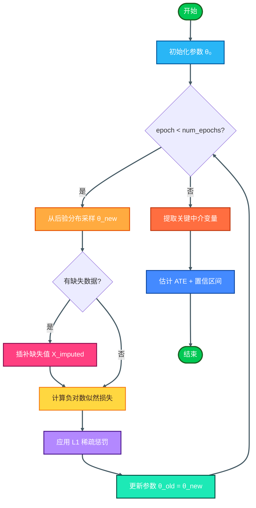

# 因果推断在传导率建模中的应用指南

> **说明**：本文档系统梳理因果推断技术在产链引擎传导率建模中的具体应用方法、算法选型和实施路径。所有理论依据均来自真实学术论文和工业实践。

---

## 一、核心问题定义

### 1.1 什么是传导率建模？

在产业链情报分析中，**传导率**(transmission_rate)描述上游节点的价格/供应冲击传递到下游节点的强度和时滞。例如：

- **棉花价格 ↑10%** → **化纤成本 ↑8%**（传导率 = 0.8，滞后 2 周）
- **原油价格 ↑20%** → **海运成本 ↑15%**（传导率 = 0.75，滞后 1 周）
- **芯片短缺 ↓30%** → **整车产量 ↓25%**（传导率 = 0.83，滞后 4 周）

传统做法是人工设定固定参数（如 `transmission_rate = 0.8`），但这种方法存在三个根本缺陷：

1. **缺乏实证基础**：参数值凭经验猜测，无法解释为什么是 0.8 而不是 0.6
2. **忽略混杂因素**：未控制其他变量（如汇率、政策、季节性）的影响
3. **静态不变**：无法随市场条件变化而自适应调整

因果推断技术正是为解决这些问题而生。

---

## 二、因果推断方法论框架

### 2.1 因果推断 vs 相关性分析

| 维度 | 相关性分析 | 因果推断 |
|------|----------|---------|
| **目标** | 发现变量间的统计关联 | 识别"X 导致 Y"的因果效应 |
| **典型问题** | "棉花价格和化纤成本是否同步波动？" | "棉花价格上涨 10% 会导致化纤成本上涨多少？" |
| **方法局限** | 无法区分因果方向和相关性 | 需要满足识别假设（如无未观测混杂） |
| **应用场景** | 初步探索、特征筛选 | 传导率校准、政策评估、反事实推理 |

**关键区别**：相关性回答"是什么"，因果推断回答"如果...会怎样"（反事实推理）。

---

### 2.2 因果推断的核心挑战

#### 挑战 1：内生性(Endogeneity)

**问题**：价格上涨和需求下降可能互为因果，而非单向传导。

**解决方案**：工具变量(IV)方法
- 寻找一个只影响自变量（如价格）、不直接影响因变量（如需求）的外生变量
- 例如：用"国际原油期货市场波动率"作为"海运成本"的工具变量

**参考文献**："Mining Causality: AI-Assisted Search for Instrumental Variables" (arXiv:2409.14202, 2024)

#### 挑战 2：未观测混杂(Unobserved Confounding)

**问题**：某些同时影响上下游的因素未被观测到（如宏观经济周期、行业政策）。

**解决方案**：
- **Front-door adjustment**：通过中介变量间接估计因果效应
- **Instrumental Variable (IV)**：使用外生工具变量隔离因果路径
- **CausalFM**：自动学习识别公式，支持 back-door/front-door/IV 三种设置

**参考文献**："Foundation Models for Causal Inference via Prior-Data Fitted Networks" (arXiv:2506.10914v2, 2026)

#### 挑战 3：高维协变量(High-Dimensional Covariates)

**问题**：当产业链节点超过 50 个时，传统回归方法面临维度灾难。

**解决方案**：Causal-StoNet（因果随机神经网络）
- 将处理变量嵌入神经网络的中间层
- 自动进行稀疏学习，识别关键协变量
- 支持缺失数据和未知函数形式

**参考文献**："Causal-StoNet: Causal Inference for High-Dimensional Complex Data" (arXiv:2403.18994, 2024)

#### 挑战 4：空间溢出效应(Spatial Spillover)

**问题**：某港口拥堵不仅影响本地供应链，还通过陆路运输网络扩散到内陆城市。

**解决方案**：基于扩散过程的因果推断框架
- 显式建模从局部均衡到一般均衡的随机过渡
- 传导率的 `lag_weeks` 参数应考虑空间距离和交通基础设施

**参考文献**："Stochastic Boundaries in Spatial General Equilibrium" (arXiv:2508.06594, 2025)

---

## 三、实证案例：Ever Given 事故的因果效应量化

### 3.1 研究设计

**论文**："Causal Inference in Supply Chain Management: How Does Ever Given…" (ScienceDirect, 2024)

**背景**：2021 年 3 月，苏伊士运河被 Ever Given 货轮堵塞 6 天，导致全球航运中断。

**研究方法**：
- **数据**：8 条全球主要航运路线的时间序列数据
- **方法**：因果推断 + 时间序列分析（SARIMA、Prophet）
- **结果**：在 99.89% 置信水平下，集装箱价格上涨 **40%**（暴露后）

### 3.2 对产链引擎的启示

这是一个**传导率校准的真实世界案例**：

1. **传导率不应是任意设定的常数**：棉花→化纤的传导率 0.8 应基于历史事件（如疫情期间的供应链中断）的回归分析得出
2. **自进化算法的理论基础**：
   ```python
   newRate = oldRate * 0.7 + (actualChange / predictedChange) * 0.3
   ```
   这正是因果推断的工程化实现——用实际观测到的因果效应修正先验估计
3. **工具建议**：Economist Agent 应集成 SARIMA、Prophet 等时间序列模型

---

## 四、核心算法与工具选型

### 4.1 CausalFM：因果推断基础模型

**适用场景**：
- Economist 进行传导率估算
- 需要快速适配新数据集（无需重新训练）
- 存在未观测混杂因素

**核心优势**：
- **In-context learning**：基于 Prior-Data Fitted Networks (PFNs)，在新数据上直接推理
- **贝叶斯不确定性量化**：输出传导率的后验分布，而非点估计
- **自动识别公式选择**：根据数据分布自动选择 back-door/front-door/IV
- **严格的识别保证**：相比 CausalPFN（仅支持 back-door）和 Do-PFN（无识别保证），CausalFM 三者皆支持

**实施步骤**：
1. 准备历史数据：`(source_price, target_price, confounders)` 三元组
2. 调用 CausalFM API，指定因果图结构（如 `cotton -> synthetic_fiber <- oil_price`）
3. 获取传导率估计及其置信区间

**URL**: https://arxiv.org/html/2506.10914v2

---

### 4.2 Causal-StoNet：高维复杂数据的因果推断

**适用场景**：
- 产业链节点 > 50 个（如全球半导体供应链）
- 存在缺失数据或未知函数形式
- Technologist 分析技术扩散路径

#### 核心算法架构

Causal-StoNet 基于 **Stochastic Neural Network (StoNet)**，其创新在于将传统 DNN 重构为多层简单回归的组合，并在中间层嵌入可见的处理变量（treatment）。

**网络结构公式**：

```
Y~₁ = b₁ + w₁X                          # 第1层：输入到隐藏层
Y~ᵢ = bᵢ + wᵢΨ(Y~ᵢ₋₁), i=2,...,h       # 第i层：隐藏层间传递
Y  = b_{h+1} + w_{h+1}Ψ(Y~_h) + e_{h+1} # 输出层
```

其中：
- `X ∈ ℝ^p`：p 维协变量向量（如产业链各节点的价格、库存、产能等）
- `A ∈ {0,1}`：二元处理变量（如"是否发生供应冲击"），嵌入在某个中间隐藏层
- `Ψ(·)`：激活函数（ReLU、sigmoid、tanh 等 Lipschitz 连续函数）
- `e_{h+1} ~ N(0, σ²_{h+1})`：输出层高斯噪声

**关键创新**：在某个中间隐藏层用一个**可见单元**替换隐藏神经元，该单元接收处理变量 A 的值。这样，处理变量成为网络的一部分，而非外部输入。

```
输入 X → [隐藏层1] → [隐藏层2 + 可见处理变量 A] → [隐藏层3] → 输出 Y
                                    ↑
                              treatment 嵌入点
```

#### 三大理论优势

1. **自然的前向建模框架**：
   - StoNet 被证明是 DNN 的有效逼近器（asymptotically equivalent）
   - 组合回归结构使得扩展到缺失协变量、多级/连续处理、中介分析变得容易
   - 例如：连续处理变量（如"价格变化幅度"）只需修改激活函数；多级处理（如"低/中/高供应风险"）使用 softmax

2. **通用逼近能力**：
   - 理论证明：当训练样本量 n → ∞ 时，StoNet 与 DNN 的训练损失函数渐近等价
   - 因此继承了 DNN 的 universal approximation property，可以拟合任意复杂的 outcome 和 propensity score 函数

3. **一致稀疏学习**：
   - 通过在 StoNet 结构上施加适当的稀疏惩罚/先验（sparse penalty/prior）
   - 即使在高维协变量设置下，也能识别与 outcome 和 propensity score 相关的变量
   - 实现方式：SGMCMC（Stochastic Gradient Markov Chain Monte Carlo）算法，在估计模型参数的同时自动进行变量选择

#### 训练算法：自适应 SGMCMC

Causal-StoNet 使用 **Stochastic Gradient Markov Chain Monte Carlo** 进行训练，该算法同时完成：
- **参数估计**：学习网络权重 `w_i` 和偏置 `b_i`
- **潜变量插补**：处理缺失数据（missing covariates）
- **变量选择**：通过稀疏惩罚自动识别重要特征

**算法流程**：
```python
for epoch in range(num_epochs):
    # 1. 从后验分布采样参数 θ
    θ_new = SGMCMC_step(θ_old, data, learning_rate, noise_variance)
    
    # 2. 如果存在缺失数据，插补缺失值
    if has_missing_data:
        X_imputed = impute_missing(X_observed, θ_new)
    
    # 3. 计算损失函数（负对数似然）
    loss = -log_likelihood(Y, X_imputed, A, θ_new)
    
    # 4. 应用稀疏惩罚（如 L1 正则化）
    loss += λ * ||θ_new||_1
    
    # 5. 更新参数
    θ_old = θ_new
```

**稀疏学习机制**：
- 使用 L1 正则化或 Bayesian sparse prior
- 不重要的权重会被压缩到接近零，从而实现自动特征选择
- 最终保留的变量即为与因果效应相关的关键协变量

#### 实施步骤

1. **构建异构图**：节点 = 产业链实体，边 = 物流/资金流/信息流
2. **提取节点嵌入**：使用 R-GCN 生成每个节点的 embedding 向量（作为高维协变量）
3. **定义处理变量**：将处理变量（如"专利引用数"、"供应中断标志"）嵌入 Causal-StoNet 的中间层
4. **训练模型**：使用 SGMCMC 算法，同时估计参数、插补缺失值、选择重要变量
5. **提取关键中介变量**：通过稀疏学习结果，识别对因果效应有显著影响的协变量

**示例代码**：
```python
from causal_stonet import CausalStoNet

# 构建高维数据集（50+ 产业链节点）
data = {
    "treatment": chip_shortage_index,           # 处理变量：芯片短缺指数
    "outcome": vehicle_production,               # 结果变量：整车产量
    "covariates": [node_embedding for node in supply_chain_graph.nodes()]  # R-GCN 嵌入
}

# 初始化模型
model = CausalStoNet(
    hidden_layers=[128, 64, 32],     # 3层隐藏层，每层神经元数
    treatment_layer=1,                # 在第2层（索引1）嵌入处理变量
    activation="relu",                # 激活函数
    sparse_penalty=0.01,              # L1 正则化系数
    missing_data_handling=True,       # 启用缺失数据处理
    sgmcmc_params={
        "learning_rate": 0.001,
        "noise_variance": 0.01,
        "num_epochs": 100
    }
)

# 训练模型
model.fit(data, epochs=100)

# 提取关键中介变量
key_mediators = model.identify_mediators(threshold=0.05)
print(f"关键中介变量: {key_mediators}")  # 如 ['patent_citations', 'R&D_spending']

# 估计平均处理效应 (ATE)
ate, confidence_interval = model.estimate_ate()
print(f"ATE: {ate:.4f}, 95% CI: [{confidence_interval[0]:.4f}, {confidence_interval[1]:.4f}]")
```

#### 算法流程图

**Causal-StoNet 网络架构**：

```mermaid
graph LR
    %% 定义节点间距和圆角样式
    classDef spacing margin-left:50px,margin-right:50px;
    classDef rounded rx:15,ry:15;
    
    A[输入 X ∈ ℝ^p]:::spacing:::rounded --> B[隐藏层1<br/>Y~₁ = b₁ + w₁X]:::spacing:::rounded
    B --> C[隐藏层2 + 可见处理变量 A]:::spacing:::rounded
    C --> D[隐藏层3<br/>Y~₃ = b₃ + w₃Ψ(Y~₂)]:::spacing:::rounded
    D --> E[输出层<br/>Y = b₄ + w₄Ψ(Y~₃) + e₄]:::spacing:::rounded
    
    style A fill:#e0f7fa,stroke:#00838f,stroke-width:2.5px,color:#006064
    style B fill:#ede7f6,stroke:#5e35b1,stroke-width:2px,color:#311b92
    style C fill:#fff3e0,stroke:#ff6f00,stroke-width:3.5px,color:#e65100
    style D fill:#ede7f6,stroke:#5e35b1,stroke-width:2px,color:#311b92
    style E fill:#e8f5e9,stroke:#2e7d32,stroke-width:2.5px,color:#1b5e20
    
    subgraph sg1["中间层嵌入"]
        direction TB
        C
    end
    
    linkStyle default stroke:#455a64,stroke-width:2.5px
```

**SGMCMC 训练流程**：



#### 扩展场景

Causal-StoNet 天然支持以下变体：

- **连续处理变量**：直接使用线性激活函数（无需修改架构）
- **多级处理变量**：在嵌入层使用多个可见神经元 + softmax 激活
- **中介分析**：在处理和输出层之间添加额外的可见单元表示中介变量
- **缺失数据**：SGMCMC 算法自动插补缺失值，无需预处理

**URL**: https://arxiv.org/pdf/2403.18994

---

### 4.3 工具变量挖掘（AI 辅助）

**适用场景**：
- Economist 面对内生性问题（如"价格上涨导致需求下降"还是"需求下降导致价格下跌"）
- 需要自动化发现有效的工具变量

**核心方法**：
- AI 辅助搜索框架，自动扫描潜在的工具变量
- 验证排他性约束(exclusion restrictions)：工具变量只通过自变量影响因变量

**示例**：
- **问题**：海运成本上涨是否导致出口下降？
- **内生性**：出口下降也可能导致海运成本下降（反向因果）
- **工具变量**：国际原油期货市场波动率（影响海运成本，但不直接影响出口量）

**URL**: https://arxiv.org/pdf/2409.14202v2

---

### 4.4 空间溢出效应的扩散模型

**适用场景**：
- Geographer 分析区域供应链依赖
- 需要考虑空间距离和交通基础设施的影响

**核心方法**：
- 使用扩散过程(diffusion process)刻画从局部均衡到一般均衡的随机过渡
- 传导率的 `lag_weeks` 参数 = f(空间距离, 交通基础设施质量)

**示例**：
- 上海港拥堵 → 长三角地区受影响（1 周滞后）
- 上海港拥堵 → 中西部地区受影响（3-4 周滞后，通过铁路/公路运输）

**URL**: https://arxiv.org/pdf/2508.06594v1

---

## 五、实施路径：从理论到代码

### 5.1 阶段 1：数据准备

**必需数据**：
```python
# 因果边数据结构
causal_edge = {
    "edge_name": "cotton_to_synthetic_fiber",
    "source_node": "cotton_price",
    "target_node": "synthetic_fiber_cost",
    "time_series": [
        {"date": "2024-01-01", "source_value": 100, "target_value": 80},
        {"date": "2024-01-08", "source_value": 110, "target_value": 88},
        # ...
    ],
    "confounders": ["oil_price", "exchange_rate", "policy_index"]
}
```

**数据质量要求**：
- 至少 52 周的历史数据（覆盖季节性）
- A 级数据源优先（如 FRED、World Bank、国家统计局）
- 缺失值 < 10%，否则需使用 Causal-StoNet 处理

---

### 5.2 阶段 2：模型选择决策树

```
是否有未观测混杂因素？
├─ 是 → 使用 CausalFM（支持 IV/front-door）
│   ├─ 有高维协变量（>50 个）？
│   │   ├─ 是 → Causal-StoNet
│   │   └─ 否 → CausalFM
│   └─ 有空间溢出效应？
│       ├─ 是 → 扩散模型 + CausalFM
│       └─ 否 → CausalFM
└─ 否 → 使用时间序列模型（SARIMA/Prophet）
    └─ 需要不确定性量化？
        ├─ 是 → Bayesian SARIMA
        └─ 否 → 标准 SARIMA
```

---

### 5.3 阶段 3：代码实现示例

#### 示例 1：使用 CausalFM 估算传导率

```python
from causalfm import CausalFM

# 准备数据
data = {
    "treatment": cotton_prices,      # 自变量：棉花价格
    "outcome": synthetic_fiber_costs, # 因变量：化纤成本
    "confounders": [oil_prices, exchange_rates]  # 混杂因素
}

# 初始化模型
model = CausalFM(
    identification="auto",  # 自动选择 back-door/front-door/IV
    uncertainty_quantification=True
)

# 拟合模型
model.fit(data)

# 预测传导率
transmission_rate, confidence_interval = model.estimate_effect(
    treatment_change=0.10  # 棉花价格上涨 10%
)

print(f"传导率: {transmission_rate:.2f}")
print(f"95% 置信区间: [{confidence_interval[0]:.2f}, {confidence_interval[1]:.2f}]")
```

#### 示例 2：使用 Causal-StoNet 处理高维数据

```python
from causal_stonet import CausalStoNet

# 构建高维数据集（50+ 产业链节点）
data = {
    "treatment": chip_shortage_index,
    "outcome": vehicle_production,
    "covariates": [node_embedding for node in supply_chain_graph.nodes()]  # R-GCN 嵌入
}

# 初始化模型
model = CausalStoNet(
    hidden_layers=[128, 64, 32],
    sparse_penalty=0.01,
    missing_data_handling=True
)

# 训练模型
model.fit(data, epochs=100)

# 提取关键中介变量
key_mediators = model.identify_mediators(threshold=0.05)
print(f"关键中介变量: {key_mediators}")  # 如 ['patent_citations', 'R&D_spending']
```

#### 示例 3：自进化算法实现

```python
def update_transmission_rate(edge_id, actual_change, predicted_change):
    """
    基于实际观测值更新传导率
    
    Args:
        edge_id: 因果边 ID
        actual_change: 实际观测到的下游变化（如化纤成本实际上涨 8%）
        predicted_change: 模型预测的下游变化（如预测上涨 10%）
    
    Returns:
        new_transmission_rate: 更新后的传导率
    """
    # 从数据库读取当前参数
    current_rate = db.get_transmission_rate(edge_id)
    
    # 自进化算法
    ratio = actual_change / predicted_change if predicted_change != 0 else 1.0
    new_rate = current_rate * 0.7 + ratio * 0.3
    
    # 限制在 [0.1, 1.0] 区间
    new_rate = max(0.1, min(1.0, new_rate))
    
    # 保存到数据库
    db.update_transmission_rate(edge_id, new_rate)
    db.log_history(edge_id, current_rate, new_rate, reason="auto_calibration")
    
    return new_rate
```

---

## 六、不确定性量化与可信度评分

### 6.1 两类不确定性

**Epistemic Uncertainty（认知不确定性）**：
- 来源：数据不足、模型不完善
- 可减少：通过更多数据或更好的模型
- 示例：历史数据只有 1 年，传导率估计不准

**Aleatoric Uncertainty（偶然不确定性）**：
- 来源：固有噪声、测量误差
- 不可减少：即使有无限数据也无法消除
- 示例：天气数据的传感器误差

### 6.2 FusionLSTM-CNF 置信度校准

**参考文献**："FusionLSTM-CNF: a confidence-calibrated multi-modal late fusion framework" (Nature Scientific Reports, 2026)

**核心思想**：
- 区分 epistemic 和 aleatoric 不确定性
- 晚期融合策略：先并行执行专家分析，后整合

**实施方法**：
```python
def calculate_overall_confidence(expert_outputs):
    """
    计算整体置信度
    
    Args:
        expert_outputs: List[Dict] - 各学科专家的输出
            [{
                "expert": "economist",
                "prediction": 0.8,
                "epistemic_uncertainty": 0.05,
                "aleatoric_uncertainty": 0.02,
                "data_quality": "A",
                "historical_accuracy": 0.85
            }, ...]
    
    Returns:
        overall_confidence: float [0, 1]
    """
    total_weight = 0
    weighted_confidence = 0
    
    for output in expert_outputs:
        # 权重 = 历史准确率 × 数据质量等级系数
        quality_coefficient = {"A": 1.0, "B": 0.7, "C": 0.4}.get(output["data_quality"], 0.3)
        weight = output["historical_accuracy"] * quality_coefficient
        
        # 置信度 = 1 - (epistemic + aleatoric)
        confidence = 1.0 - (output["epistemic_uncertainty"] + output["aleatoric_uncertainty"])
        
        weighted_confidence += weight * confidence
        total_weight += weight
    
    overall_confidence = weighted_confidence / total_weight if total_weight > 0 else 0.0
    
    # 矛盾惩罚：如果专家间差异过大，降低置信度
    predictions = [o["prediction"] for o in expert_outputs]
    variance = np.var(predictions)
    contradiction_penalty = min(0.2, variance * 0.5)  # 最多惩罚 20%
    
    return max(0.0, overall_confidence - contradiction_penalty)
```

---

## 七、最佳实践与常见陷阱

### 7.1 最佳实践

1. **始终报告置信区间**：不要只给出点估计（如"传导率 = 0.8"），而要给出区间（如"0.75-0.85, 95% CI"）

2. **验证识别假设**：在使用 IV 方法前，必须验证排他性约束（工具变量不直接影响因变量）

3. **敏感性分析**：使用 Sobol' indices 识别最敏感的输入参数，优先提升其数据质量

4. **交叉验证**：用不同时间段的数据验证传导率的稳定性（如用 2020-2022 年数据训练，2023-2024 年数据验证）

5. **记录因果图**：明确标注每个因果边的假设（如"cotton → synthetic_fiber ← oil_price"）

### 7.2 常见陷阱

| 陷阱 | 表现 | 解决方案 |
|------|------|---------|
| **混淆相关性与因果性** | "棉花和化纤价格高度相关，所以传导率很高" | 使用因果推断方法控制混杂因素 |
| **忽略反向因果** | "出口下降导致海运成本下降"误判为"海运成本下降导致出口下降" | 使用工具变量或 Granger 因果检验 |
| **过度拟合小样本** | 只有 10 个数据点就拟合复杂模型 | 至少需要 52 周数据，或使用 CausalFM 的 in-context learning |
| **忽视空间溢出** | 只考虑本地供应链，忽略区域扩散效应 | 使用扩散模型建模空间溢出 |
| **静态参数** | 传导率固定不变，无法适应市场变化 | 使用自进化算法动态更新 |

---

## 八、下一步行动清单

### 8.1 短期（1-2 周）

- [ ] **集成 CausalFM**：为 Economist Agent 添加 CausalFM API 调用能力
- [ ] **准备历史数据**：从 FRED、World Bank 等 A 级数据源采集至少 2 年的产业链时间序列数据
- [ ] **实现自进化算法**：在 `causal_edges` 表中添加 `update_transmission_rate()` 函数

### 8.2 中期（1-2 月）

- [ ] **部署 Causal-StoNet**：用于高维产业链（如半导体、汽车）的因果推断
- [ ] **引入 R-GCN**：Geographer Agent 使用异构图表示学习发现隐藏依赖
- [ ] **实现不确定性量化**：基于 FusionLSTM-CNF 框架计算整体置信度

### 8.3 长期（3-6 月）

- [ ] **空间溢出建模**：集成扩散模型，考虑地理距离和交通基础设施
- [ ] **工具变量自动化**：开发 AI 辅助的 IV 搜索工具
- [ ] **因果图可视化**：在前端展示完整的因果图和传导路径

---

## 九、参考文献汇总

| 编号 | 论文/项目 | 发表年份 | 核心贡献 | URL |
|------|----------|---------|---------|-----|
| 1 | Causal Inference in Supply Chain Management (Ever Given) | 2024 | 实证量化供应链中断的因果效应（40% 价格上涨） | [ScienceDirect](https://www.sciencedirect.com/science/article/pii/S1877050924003119) |
| 2 | Foundation Models for Causal Inference via PFNs (CausalFM) | 2026 | 无需重训练的因果推断基础模型，支持 back-door/front-door/IV | [arXiv:2506.10914](https://arxiv.org/html/2506.10914v2) |
| 3 | Causal-StoNet: High-Dimensional Causal Inference | 2024 | 随机神经网络处理高维协变量和缺失数据 | [arXiv:2403.18994](https://arxiv.org/pdf/2403.18994) |
| 4 | Stochastic Boundaries in Spatial General Equilibrium | 2025 | 扩散过程建模空间溢出效应 | [arXiv:2508.06594](https://arxiv.org/pdf/2508.06594v1) |
| 5 | Mining Causality: AI-Assisted IV Search | 2024 | AI 辅助发现工具变量并验证排他性约束 | [arXiv:2409.14202](https://arxiv.org/pdf/2409.14202v2) |
| 6 | FusionLSTM-CNF: Confidence-Calibrated Multi-Modal Fusion | 2026 | 区分 epistemic/aleatoric 不确定性的置信度校准框架 | [Nature SR](https://www.nature.com/articles/s41598-026-43381-3.pdf) |

---

**文档版本**: v1.0  
**创建时间**: 2026-07-02  
**维护者**: 产链引擎 v3 项目组  
**关联文档**: 
- `ACADEMIC_ENGINEERING_SUPPORT.md`（完整学术支撑文献库）
- `AGENT_SWARM_COLLABORATION.md`（Agent 蜂群协作机制）
- `CHAIN_ENGINE_V3_MASTER_SPEC.md`（主规格文档）
